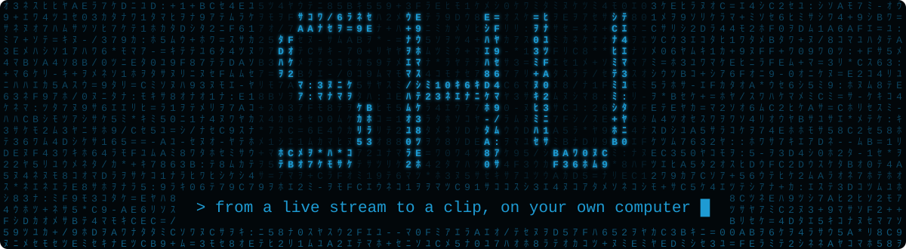

  

**We build small, honest tools that run on your own computer.** 
Paid once, no subscriptions, no accounts, nothing uploaded. Made in Spain.

`01` [Built with](#01-built-with) &nbsp;`02` [Links](#02-links) &nbsp;`03` [Link Lite](#03-link-lite-recorder) &nbsp;`04` [Link TURBO](#04-link-turbo)

## `01` Built with

## `02` Links

| | |
|---|---|
| Website | [linkturbo.app](https://linkturbo.app) |
| Chrome Web Store | [Link Lite Recorder](https://chromewebstore.google.com/detail/link-lite-recorder/jjbnifoddmcjocjdmiaondcimkjmkjaa) |
| Discord | [discord.gg/N3jdn6WPJd](https://discord.gg/N3jdn6WPJd) |
| The guide | [linkturbo.app/how-it-works](https://linkturbo.app/how-it-works) |
| Buying and the licence key | [linkturbo.app/buy](https://linkturbo.app/buy) |
| What's new | [linkturbo.app/changelog](https://linkturbo.app/changelog) |
| Support | [support@linkturbo.app](mailto:support@linkturbo.app) |

**News comes to Discord first: releases, updates, and what is being built next.**

## `03` Link Lite Recorder

**A browser extension for Chrome, Edge and Brave.** It records the Kick or Twitch stream playing in your tab, lets you mark the highlights as they happen, and saves one mp4 to your own computer.

 

 

| | |
|---|---|
| **● Record** | Picture and sound, cut out of the page. One mp4, up to 30 minutes. |
| **★ Mark** | A hotkey and a few words ("clutch 1v3"). Or by itself, when chat speeds up. |
| **⟲ Rewind** | Switched on, it keeps the last 3 minutes, so a moment can be saved after it happened. |
| **▣ For your editor** | The marks come with the recording: a list to copy, or a marker file for DaVinci Resolve. |
| **⌂ Stays on your computer** | Nothing is uploaded. No account, no analytics. |

<table>
<tr>
<td width="50%"></td>
<td width="50%"></td>
</tr>
</table>

<b>Skins for the panel</b> &nbsp;·&nbsp; five colour skins with moving backgrounds

 

Try any of them on before you buy. **EUR 0.99 each, paid once.** Classic stays free.

### [Add Link Lite Recorder to your browser →](https://chromewebstore.google.com/detail/link-lite-recorder/jjbnifoddmcjocjdmiaondcimkjmkjaa)

## `04` Link TURBO

**The full program for Windows: from a live stream to a posted reel, on one computer.**

 

| | | |
|---|---|---|
| **01 · Record** | Studio | Up to 3 Kick or Twitch streams recorded at once. |
| **02 · Find** | Moments found for you | Up to 30 ranked moments per recording. |
| **03 · Edit** | Finished 9:16 clips | Title, hook and captions timed to the voice. |
| **04 · Post** | YouTube Shorts and Instagram | Only the clips you choose leave your computer. |
| **05 · Measure** | Analytics | See how each clip did: 7 days, 28 days or all time. |
| **06 · Night** | Link Night | Records your streams while you sleep and has the moments ranked when you are back. |

> Not released yet. The release date is posted in [Discord](https://discord.gg/N3jdn6WPJd) first.

Link is a tool. Record your own streams, or streams whose owner allows it. Not affiliated with Kick or Twitch.

